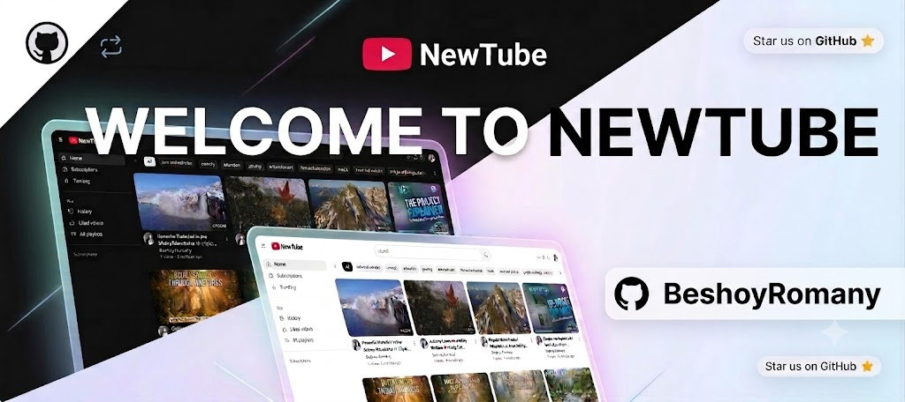

<div align="center">



# 📺 NewTube

**A full-stack, YouTube-style video streaming platform**

Real-time video processing, AI-generated metadata, and a complete creator studio.

<p>
  
  
  
  
  
  
  
</p>

</div>

---

## 📖 Overview

NewTube replicates the core YouTube experience end to end. Creators upload video that is encoded and streamed through **Mux**; processing status flows back through signature-verified webhooks and reaches the UI over **Pusher** websockets in real time; and background **Upstash Workflow** jobs generate SEO titles, descriptions, and thumbnails from the auto-generated transcript.

The entire API surface is **end-to-end type-safe** — a change to a Drizzle column propagates through the tRPC router into React component props with no codegen step and no hand-written API types.

---

## ✨ Features

### 🎬 Video & Streaming

- **Direct-to-Mux uploads** with adaptive-bitrate encoding and delivery
- **Live processing status** — `preparing → ready → errored` pushed to the studio over websockets, no polling
- **Auto-generated English subtitles** via Mux AI transcription
- **Animated hover previews** (GIF) generated per video at upload time
- **Automatic duration and thumbnail extraction** from the encoded asset

### 🤖 AI Creator Tools

- **AI title generation** — SEO-focused titles written from the video transcript (`gpt-4o-mini`)
- **AI description generation** — structured summaries of the video content
- **AI thumbnail generation** — custom artwork from a text prompt (`DALL·E 3`), uploaded and swapped in place
- Each runs as a **durable, individually-retryable background job** — the browser can close mid-run

### 📺 Viewing Experience

- **Infinite-scroll feeds** — Home, Trending, and Subscriptions
- **Full-text search** with category filtering
- **Nested comments** with replies and per-comment reactions
- **Likes / dislikes** and accurate view counting
- **Watch history** tracked automatically
- **Suggested videos** on the watch page
- **Dark / light / system theme** with no flash on load

### 👤 Channels & Social

- **Channel pages** with custom banner and avatar
- **Subscribe / unsubscribe** with live subscriber counts
- **Playlists** — create, add, and remove, plus built-in *Liked* and *History* collections

### 🎛️ Creator Studio

- Dashboard listing every upload with views, comments, and likes
- Full metadata editing — title, description, category, visibility, thumbnail
- **Public / private** visibility control
- Thumbnail upload, AI generation, or restore-to-default

### 🔐 Platform

- **Clerk authentication**, with the user table kept in sync through signed webhooks
- **Rate limiting** on every authenticated mutation (Upstash Redis sliding window)
- **Signature-verified webhooks** for both Mux and Clerk
- **Idempotent, race-safe webhook handling** — duplicate deliveries can't corrupt state or orphan files

---

## 🧰 Tech Stack

| Layer | Technology |
| :--- | :--- |
| **Framework** | Next.js 15 (App Router, React Server Components) |
| **Language** | TypeScript 5 (strict) |
| **UI** | React 19, Tailwind CSS, shadcn/ui, Radix UI, Lucide |
| **API** | tRPC 11 — end-to-end type safety, superjson |
| **Data fetching** | TanStack Query 5 (suspense + infinite queries) |
| **Database** | PostgreSQL on Neon (serverless HTTP driver) |
| **ORM** | Drizzle ORM + drizzle-zod |
| **Auth** | Clerk |
| **Video** | Mux — encoding, streaming, AI subtitles, webhooks |
| **File storage** | UploadThing |
| **Background jobs** | Upstash Workflow (QStash) |
| **Rate limiting** | Upstash Redis + `@upstash/ratelimit` |
| **Realtime** | Pusher Channels |
| **AI** | OpenAI `gpt-4o-mini` (titles, descriptions) and `DALL·E 3` (thumbnails) |
| **Forms** | React Hook Form + Zod |
| **Runtime / PM** | Bun |
| **Deployment** | Vercel |

---

## 🚀 Getting Started

### 1. Prerequisites

- **Bun** ≥ 1.0 (or Node.js 20+)
- A **Neon** PostgreSQL database
- Accounts for **Clerk**, **Mux**, **UploadThing**, **Upstash**, **Pusher**, and **OpenAI**

### 2. Clone and install

```bash
git clone https://github.com/BeshoyRomany/new-tube.git
cd new-tube
bun install
```

### 3. Environment variables

Create a `.env.local` file in the project root:

```bash
# App — must match the URL the browser and webhooks actually use
NEXT_PUBLIC_APP_URL=https://localhost:3001

# Database (Neon)
DATABASE_URL=postgresql://...

# Clerk Auth
NEXT_PUBLIC_CLERK_PUBLISHABLE_KEY=
CLERK_SECRET_KEY=
CLERK_WEBHOOK_SIGNING_SECRET=
NEXT_PUBLIC_CLERK_SIGN_IN_URL=/sign-in
NEXT_PUBLIC_CLERK_SIGN_UP_URL=/sign-up

# Mux Video
MUX_TOKEN_ID=
MUX_TOKEN_SECRET=
MUX_WEBHOOK_SECRET=

# UploadThing
UPLOADTHING_TOKEN=

# Upstash (Redis + Workflow/QStash)
UPSTASH_REDIS_REST_URL=
UPSTASH_REDIS_REST_TOKEN=
QSTASH_TOKEN=

# Pusher (realtime)
PUSHER_APP_ID=
PUSHER_SECRET=
NEXT_PUBLIC_PUSHER_APP_KEY=
NEXT_PUBLIC_PUSHER_CLUSTER=

# OpenAI
OPENAI_API_KEY=
```

### 4. Set up the database

```bash
bun run db:push              # push the schema to Neon
bun run db:seed-categories   # seed video categories
```

### 5. Run it

```bash
bun run dev:all
```

`dev:all` starts everything the app needs at once:

| Process | Purpose |
| :--- | :--- |
| `next dev` | App server on **:3000** |
| `ngrok http 3000` | Public tunnel so Mux and Clerk webhooks can reach your machine |
| `local-ssl-proxy` | HTTPS proxy on **:3001** — Mux Uploader requires a secure origin |
| `drizzle-kit studio` | Database GUI |

Then open **https://localhost:3001**.

> **⚠️ Webhooks:** paste the public ngrok URL into your **Clerk** dashboard (`/api/users/webhook`) and your **Mux** dashboard (`/api/videos/webhook`). Without this, uploaded videos stay stuck on *preparing* and new sign-ups never reach the database.

To run just the app, without tunnelling or the DB GUI:

```bash
bun run dev
```

---

## 📜 Scripts

| Command | Description |
| :--- | :--- |
| `bun run dev` | Start the Next.js dev server |
| `bun run dev:all` | Dev server + ngrok + SSL proxy + Drizzle Studio |
| `bun run build` | Production build (also the type-check gate) |
| `bun run start` | Serve the production build |
| `bun run lint` | Run ESLint |
| `bun run db:push` | Push `schema.ts` to the database |
| `bun run db:studio` | Open Drizzle Studio |
| `bun run db:seed-categories` | Seed the categories table |

---

## 🏗️ Architecture

### Modular by feature

Every feature is self-contained — its tRPC router, derived types, and UI all live together:

```
src/
├── app/                       # Next.js routes — thin: prefetch data, render a view
│   ├── (home)/                # Feed, search, watch page, playlists, channels
│   ├── (studio)/              # Creator dashboard
│   ├── (auth)/                # Clerk sign-in / sign-up
│   └── api/                   # tRPC handler, webhooks, AI workflows, uploads
├── modules/<feature>/
│   ├── server/procedures.ts   # tRPC router
│   ├── types.ts               # types inferred from router output
│   └── ui/{views,sections,components}
├── db/schema.ts               # Single Drizzle schema
├── trpc/                      # Router registry, server caller, client provider
├── lib/                       # Mux, Pusher, Redis, UploadThing, Workflow clients
└── components/ui/             # shadcn/ui primitives
```

Pages prefetch on the server and hydrate on the client, so feeds render immediately without a loading waterfall.

### The video pipeline

```
Upload → Mux encodes → signed webhook → thumbnail + preview to UploadThing
       → conditional DB write → Pusher event → studio UI updates live
```

The `video.asset.ready` handler is deliberately ordered **read → upload → conditional write**: the long file upload happens *outside* any row lock, and the final write only lands if the row hasn't already been claimed. Duplicate webhook deliveries are therefore safe and never leave orphaned files behind.

### AI jobs

Title, description, and thumbnail generation each run as an Upstash Workflow. Every step — fetch transcript, call the model, write to the DB, notify the client — is a separate durable checkpoint, so a failure retries that step alone instead of re-running the whole job or paying twice for a completed model call.

### Realtime

Server events are published on a per-video channel, and the client responds by **invalidating the relevant query** rather than merging the payload into local state. The UI refetches from the single source of truth, so it can never drift out of sync with the database.

---

## 📄 License

Released under the MIT License.

---

<div align="center">

**Built by [Beshoy Romany](https://github.com/BeshoyRomany)**

⭐ If you find this project useful, consider giving it a star!

</div>
